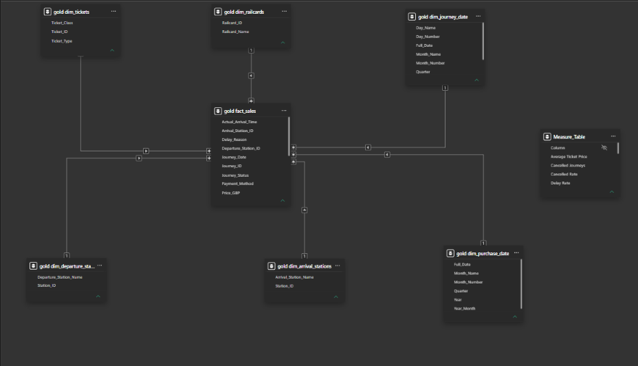
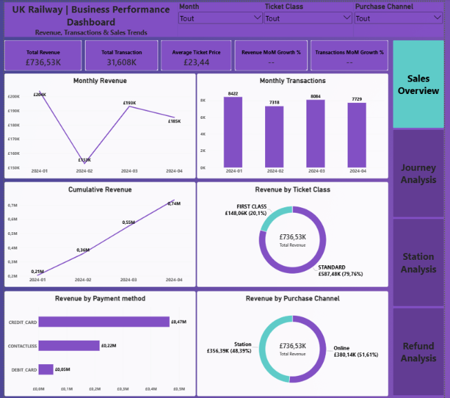
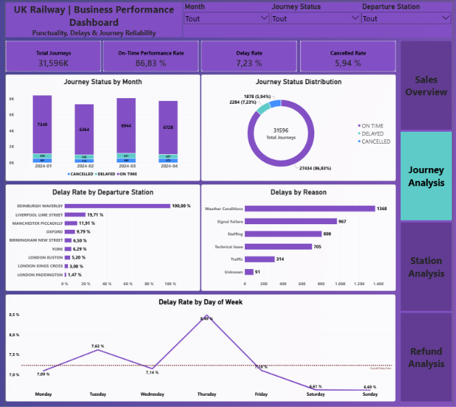
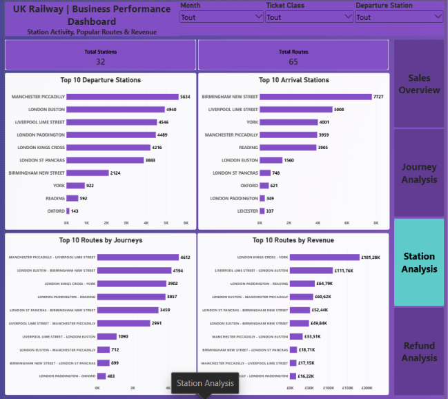
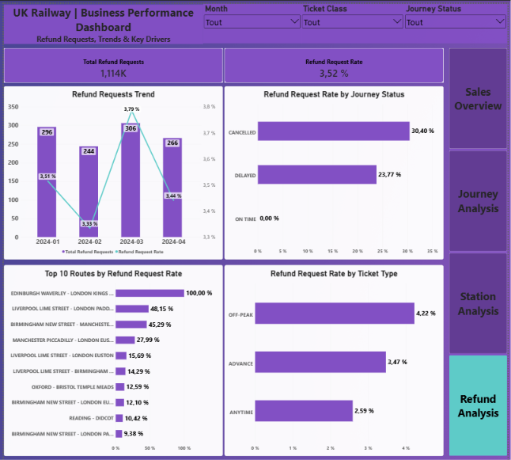

# UK Railway Data Analytics | SQL Server & Power BI

## Project Overview

This end-to-end data analytics project explores UK railway ticket sales, journey reliability, station activity, and refund requests using **SQL Server and Power BI**.

The project demonstrates the complete analytics workflow: from raw data preparation and SQL-based transformations to dimensional modeling, KPI development, and interactive business intelligence dashboards.

**Business Goal:** Transform railway transactional and operational data into meaningful insights to support revenue monitoring, service reliability analysis, and data-driven decision-making.

### Tools & Technologies

- **SQL Server (T-SQL)** — Data cleaning, transformation, and analytical views
- **Data Warehousing** — Bronze, Silver, and Gold architecture
- **Dimensional Modeling** — Star schema with fact and dimension views
- **Power BI** — Data modeling, DAX measures, and interactive dashboards
- **Power Query** — Data connectivity and preparation
- **GitHub** — Project documentation and version control

---

## Dataset

**Source:** [UK Train Rides — Maven Analytics](https://mavenanalytics.io/data-playground/uk-train-rides)

This project is based on a synthetic dataset of UK railway ticket transactions and journeys, primarily covering January to April 2024.

The original dataset includes information about:

- Ticket purchases and prices
- Purchase channels and payment methods
- Departure and arrival stations
- Journey dates and scheduled times
- Journey status, delays, and cancellations
- Railcards and ticket categories
- Refund requests

For this project, the source data was organized into six relational tables to implement a structured data warehouse architecture in SQL Server.

---

## Business Objectives

The project focuses on four key business questions:

1. **Sales Performance:** How are revenue, transaction volumes, and ticket prices evolving over time?
2. **Journey Reliability:** How reliable are railway services, and what are the main causes of delays and cancellations?
3. **Station & Route Performance:** Which stations and routes generate the most activity and revenue?
4. **Refund Analysis:** How do refund requests vary across journey statuses, ticket types, and railway routes?

---

## Data Warehouse Architecture

The project follows a **Bronze → Silver → Gold** architecture implemented using SQL Server.

### Bronze Layer — Raw Data

The Bronze layer stores the original source data in six tables:

- `bronze.sales`
- `bronze.journeys`
- `bronze.stations`
- `bronze.tickets`
- `bronze.railcards`
- `bronze.refunds`

Raw columns are initially stored as text to preserve source values before applying cleaning and type conversions.

### Silver Layer — Data Cleaning & Transformation

The Silver layer uses SQL views to clean and standardize the raw data.

Key transformations include:

- Removing exact duplicate rows using `DISTINCT`
- Trimming unnecessary spaces
- Filtering records with missing essential identifiers
- Converting text values into dates, times, and numeric types using `TRY_CAST`
- Standardizing categorical values and journey statuses
- Normalizing delay reasons and payment methods
- Replacing negative ticket prices with `NULL`

Using SQL views allows the transformation logic to remain reusable without creating unnecessary physical copies of the data.

### Gold Layer — Dimensional Modeling

The Gold layer provides an analytical model designed for Power BI reporting.

**Fact View:**
- `gold.fact_sales`

**Dimension Views:**
- `gold.dim_tickets`
- `gold.dim_railcards`
- `gold.dim_departure_stations`
- `gold.dim_arrival_stations`
- `gold.dim_purchase_date`
- `gold.dim_journey_date`

An additional `gold.dim_date` view generates the calendar used by the purchase and journey date dimensions.

The fact view combines ticket sales, journey information, and refund requests using SQL joins.

Separate departure and arrival station dimensions, along with separate purchase and journey date dimensions, support different analytical perspectives.

### Power BI Star Schema



The dimensional model enables efficient reporting across commercial and operational business areas.

---

## Power BI Dashboard

The Power BI report contains **four interactive dashboard pages**.

### 1. Sales Overview

*Revenue, Transactions & Sales Trends*



**Business Objective:** Monitor sales performance and identify commercial trends.

**Key KPIs:**
- Total Revenue
- Total Transactions
- Average Ticket Price
- Revenue Month-over-Month Growth
- Transactions Month-over-Month Growth

**Visualizations:**
- Monthly Revenue
- Monthly Transactions
- Cumulative Revenue
- Revenue by Ticket Class
- Revenue by Payment Method
- Revenue by Purchase Channel

**Interactive Filters:** Purchase Month, Ticket Class, Purchase Channel.

### 2. Journey Analysis

*Punctuality, Delays & Journey Reliability*



**Business Objective:** Evaluate railway service reliability and identify operational issues.

**Key KPIs:**
- Total Journeys
- On-Time Performance
- Delay Rate
- Cancellation Rate

**Visualizations:**
- Journey Status by Month
- Journey Status Distribution
- Delay Rate by Departure Station
- Delays by Reason
- Delay Rate by Day of Week

**Interactive Filters:** Journey Month, Departure Station, Journey Status.

On-time performance excludes cancelled journeys from the punctuality denominator.

### 3. Station Analysis

*Station Activity, Popular Routes & Revenue*



**Business Objective:** Identify the busiest stations, most frequently used routes, and highest-revenue connections.

**Key KPIs:**
- Total Stations
- Total Identified Routes

**Visualizations:**
- Top 10 Departure Stations by Journeys
- Top 10 Arrival Stations by Journeys
- Top 10 Routes by Journeys
- Top 10 Routes by Revenue

**Interactive Filters:** Journey Month, Ticket Class, Departure Station.

This dashboard combines station activity and commercial performance to provide insights into the railway network.

### 4. Refund Analysis

*Refund Requests, Trends & Key Drivers*



**Business Objective:** Understand refund request patterns and their relationship with service disruptions.

**Key KPIs:**
- Total Refund Requests
- Refund Request Rate

**Visualizations:**
- Monthly Refund Requests and Refund Request Rate
- Refund Request Rate by Journey Status
- Top 10 Routes by Refund Request Rate
- Refund Request Rate by Ticket Type

**Interactive Filters:** Journey Month, Journey Status, Ticket Class.

Contextual tooltips provide transaction and refund volumes to help interpret refund rates.

---

## Key Performance Indicators

The analysis provides the following results:

| KPI | Result |
|---|---:|
| Total Revenue | £736.5K |
| Total Transactions | Approximately 31.6K |
| Average Ticket Price | £23.44 |
| Total Journeys | 31,596 |
| On-Time Performance | 86.83% |
| Delay Rate | 7.23% |
| Cancellation Rate | 5.94% |
| Total Stations | 32 |
| Identified Routes | 65 |
| Total Refund Requests | 1,114 |
| Refund Request Rate | 3.52% |

These results describe the analyzed dataset and do not represent current UK railway performance.

---

## Key Analytical Findings

### 1. Railway Service Reliability

- Most journeys were completed on time, with an on-time performance rate of approximately 86.83%.
- Delayed and cancelled journeys represent important operational challenges.
- Analyzing delays by station, reason, and day of the week helps identify potential areas for operational improvement.

### 2. Refund Requests & Journey Disruptions

Refund requests are strongly associated with disrupted journeys.

| Journey Status | Refund Request Rate |
|---|---:|
| Cancelled | 30.40% |
| Delayed | 23.77% |
| On Time | 0.00% |

This highlights the relationship between service reliability and refund requests.

### 3. Ticket Type & Refund Behavior

Refund request rates also vary by ticket type.

| Ticket Type | Refund Request Rate |
|---|---:|
| Off-Peak | 4.22% |
| Advance | 3.47% |
| Anytime | 2.59% |

These differences provide additional context for understanding customer refund behavior.

### 4. Station & Route Performance

The Station Analysis dashboard identifies the busiest stations and highest-performing routes based on journey volumes and revenue.

Combining operational and financial metrics makes it possible to evaluate both network activity and commercial importance.

---

## Data Quality & Modeling Decisions

Several data quality challenges were identified during development.

### Missing & Invalid Values

- Invalid dates and times are handled using `TRY_CAST`.
- Negative ticket prices are replaced with `NULL`.
- Missing essential identifiers are excluded from relevant Silver views.
- Categorical values are standardized for consistent reporting.

### Unmatched Station Identifiers

Some journey records contain station identifiers that do not exist in the station reference table, including `ST998` and `ST999`.

These records were retained rather than assigned invented station names.

Routes are generated only when both departure and arrival stations can be identified.

As a result, the Total Routes KPI counts **65 identified routes**, rather than every distinct combination of station identifiers.

### Reporting Period

The main sales analysis focuses on transactions from January 2024 onward.

December 2023 was excluded because the dataset contained only 33 transactions for that month, making it unsuitable for comparison with the following months.

### View-Based Architecture

The Silver and Gold layers are implemented using SQL views rather than physical warehouse tables.

This approach provides reusable transformation logic and reduces data duplication. However, the underlying queries must be executed when the views are accessed.

---

## Repository Structure

```text
UK-Railway-Data-Analytics/
│
├── Images/
│   ├── 01_Sales_Overview.png
│   ├── 02_Journey_Analysis.png
│   ├── 03_Station_Analysis.png
│   ├── 04_Refund_Analysis.png
│   └── 05_Star_Schema_Data_Model.png
│
├── Power BI/
│   └── UK_Railway_Business_Performance_Dashboard.pbix
│
├── SQL/
│   ├── 01_create_database.sql
│   ├── 02_bronze_tables.sql
│   ├── 03_silver_views.sql
│   └── 04_gold_views.sql
│
└── README.md
```

---

## How to Reproduce the Project

### Requirements

- Microsoft SQL Server 2022 or later, with support for `GENERATE_SERIES` and the required database compatibility level
- SQL Server Management Studio (SSMS)
- Power BI Desktop
- Original dataset from Maven Analytics

### Execution Steps

**Step 1 — Create Database and Schemas**

Execute:

`SQL/01_create_database.sql`

This creates the `UK_Railway_DWH` database and the Bronze, Silver, and Gold schemas.

**Step 2 — Create Bronze Tables**

Execute:

`SQL/02_bronze_tables.sql`

This creates the six raw data tables.

**Step 3 — Import Source Data**

Download the original dataset from Maven Analytics and prepare/import the corresponding source tables into the Bronze layer.

**Step 4 — Create Silver Views**

Execute:

`SQL/03_silver_views.sql`

This creates the data cleaning and transformation views.

**Step 5 — Create Gold Views**

Execute:

`SQL/04_gold_views.sql`

This creates the analytical fact and dimension views.

**Step 6 — Open Power BI Dashboard**

Open:

`Power BI/UK_Railway_Business_Performance_Dashboard.pbix`

Update the SQL Server connection settings if necessary, then refresh the data.

**Note:** The repository contains SQL scripts and the Power BI report. The original source data must be obtained separately. The source-to-Bronze preparation process is not included as an automated import script.

---

## Skills Demonstrated

### SQL & Data Warehousing

- SQL Server / T-SQL
- Data cleaning and validation
- Common Table Expressions (CTEs)
- SQL joins and transformations
- Conditional logic using `CASE`
- Data type conversions using `TRY_CAST`
- SQL views
- Bronze, Silver, and Gold architecture
- Dimensional modeling

### Power BI & Business Intelligence

- Star schema modeling
- DAX measures and calculated KPIs
- Time-based performance analysis
- Interactive dashboard development
- Data visualization
- Business performance reporting
- Operational and financial analysis

---

## Conclusion

This project demonstrates how raw transactional and operational data can be transformed into a structured analytical model and an interactive business intelligence solution.

By combining SQL Server, data warehousing principles, dimensional modeling, and Power BI, the project provides a consolidated view of railway sales, journey reliability, station activity, and refund requests.

The resulting dashboards support data exploration, performance monitoring, and business decision-making.
